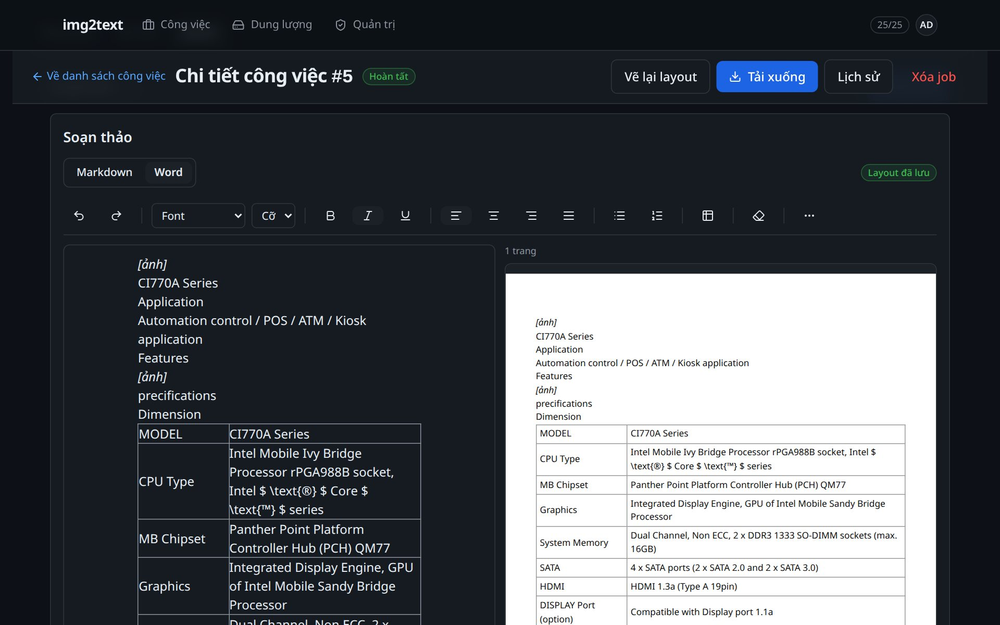

# img2text

Biến ảnh chụp và PDF (đề thi, tài liệu scan) thành văn bản **sửa được**: OCR chạy
PaddleOCR-VL trên GPU free tier, server chỉ là tầng I/O. Kết quả giữ cấu trúc
(đoạn, tiêu đề, bảng, danh sách) thay vì một mớ chữ phẳng, xuất ra Markdown /
HTML / DOCX / PDF.



## Tính năng

| | |
|---|---|
| **OCR có cấu trúc** | PaddleOCR-VL v1.5 trả markdown + regions (bbox, độ tin cậy) → IR |
| **Sửa lỗi tại chỗ** | Từ nghi lỗi được đánh dấu cạnh ảnh gốc, sửa một chỗ áp cho mọi lần xuất |
| **Soạn thảo như Word** | TipTap: font, cỡ chữ, bảng, canh lề; xem trước trang A4 thật bên cạnh |
| **Xuất tất định** | md / html / docx / pdf dựng từ IR, cache trong R2 theo version |
| **Nhiều nguồn ảnh** | JPG, PNG, WebP, PDF; upload nhiều file, crop, xoay, chọn trang |
| **Tự vận hành** | Server tự spawn worker Kaggle khi có job trong hàng đợi |
| **Quản trị** | Duyệt quyền OCR, quota, storage, log, cấu hình hệ thống |

Ảnh sản phẩm: [`web/public/shots`](web/public/shots) — chụp lại bằng
`node scripts/landing-shots.mjs` (xem [web/README.md](web/README.md)).

## Kiến trúc

```
Browser (Vite React SPA)
   │  JWT httpOnly cookie
   ▼
Nginx ── serves built SPA + reverse proxy /api/  (deploy/nginx.conf)
   ▼
FastAPI (uvicorn) ── APScheduler: lease reaper, log/token pruning, Kaggle orchestration
   ├── Postgres 16 (auth, jobs, result JSONB, request_logs, settings)
   ├── Cloudflare R2 qua presigned URL (uploads/ exports/ crops/)
   ├── LLM — layout exports: docx-layout, md-layout
   └── pandoc + weasyprint (exports, cache trong R2)
   ▲
   │  pull: GET /api/jobs/next   (Bearer RUNNER_KEY)
Kaggle / Colab worker (GPU)   worker/ + deploy/kaggle/
   pdftoppm → pre-check → PaddleOCR-VL → verdicts → POST result
```

```
server/   FastAPI + pytest           web/     SPA (React 19, Vite, Tailwind 4)
worker/   notebook + verdict logic   deploy/  compose, nginx, Kaggle, .env.example
docs/     spec, setup, research      web/public/shots/  ảnh cho landing
```

## Quickstart — development

```bash
cp deploy/.env.dev.example deploy/.env.dev
docker compose -f deploy/docker-compose.dev.yml up -d --build   # Postgres :5433, LocalStack :4566, API :8010
curl -s localhost:8010/healthz                                  # {"status":"ok","db":true}

cd web && npm install && npm run dev                            # http://localhost:5173
```

Vite proxy `/api` → `:8010` (`web/vite.config.ts`). Admin đầu tiên tạo từ
`ADMIN_EMAIL`/`ADMIN_PASSWORD` lần boot đầu. TLS để ngoài nginx.

Chạy test:

```bash
cd server && .venv/bin/pytest -v      # cần Postgres :5433 — docker compose -f deploy/docker-compose.test.yml up -d --wait
cd worker && .venv/bin/pytest -v
cd web && npm test                    # vitest; npm run lint = oxlint
```

## Quickstart — production

```bash
cd web && npm run build               # tsc -b && vite build → web/dist
cd .. && cp deploy/.env.example deploy/.env       # điền APP_SECRET, RUNNER_KEY, BASE_URL, ADMIN_*, R2_*, SMTP_*
docker compose -f deploy/docker-compose.yml up -d --build
```

- Nginx phục vụ `web/dist` + proxy `/api/`, listen HTTP :80 (TLS do proxy ngoài
  terminate), có healthcheck cho cả server và nginx.
- **Một uvicorn worker theo thiết kế** — rate limit trong process (auth
  10 req/h/IP, upload 20 job/ngày/user). Scale worker phải chuyển limit sang Postgres.
- DB đã tồn tại: `create_all` không ALTER — chạy migration tay trong
  [docs/migrations](docs/migrations).

## Worker

Server chọn worker bằng `KAGGLE_MODE` (mặc định `session`):

| Mode | Cách chạy |
|---|---|
| `session` | 1 kernel session sống ~9h, tự claim → OCR → upload → lặp; server giữ watchdog + respawn |
| `batch` *(deprecated)* | Server stage file vào dataset, push kernel script, poll kết quả |
| `loop` *(Plan K2)* | Kernel worker poll `/api/jobs/next` — cần URL public + Kaggle Secrets |

Bật orchestration cần đủ `KAGGLE_USERNAME` + (`KAGGLE_KEY` hoặc
`KAGGLE_API_TOKEN`) + `KAGGLE_KERNEL_REF`; thiếu thì feature tự tắt, server không
import `kaggle`. Chi tiết + quota: [deploy/kaggle/README.md](deploy/kaggle/README.md).

**Không có GPU?** Upload sẽ nằm `queued`. Để phát triển UI, đẩy một result giả:

```bash
# 1. Nhận job (job_id + worker_token)
curl -X GET localhost:8010/api/jobs/next -H "Authorization: Bearer dev-runner-key"
# 2. POST /api/jobs/{id}/result với JSON result (markdown + pages[].regions)
```

Job chuyển `done` → luồng preview / sửa / export dùng được ngay.

## Cấu hình

Toàn bộ biến môi trường ở `deploy/.env.example` (prod) và
`deploy/.env.dev.example` (dev). `server/tests/test_env_parity.py` fail nếu
`.env` lệch `Settings`.

| Biến | Ý nghĩa |
|---|---|
| `APP_SECRET`, `BASE_URL` | JWT signing, URL công khai của app |
| `DATABASE_URL` | Postgres async DSN |
| `R2_ENDPOINT`, `R2_BUCKET`, `R2_ACCESS_KEY_ID`, `R2_SECRET_ACCESS_KEY` | object storage |
| `STORAGE_PUBLIC_ENDPOINT` | host browser dùng để tải presigned URL (dev khác host server) |
| `RUNNER_KEY` | Bearer key cho worker poll `/api/jobs/next` |
| `ADMIN_EMAIL`, `ADMIN_PASSWORD` | bootstrap admin lần boot đầu |
| `ALLOWED_ORIGINS` | regex origin cho CORS (comma-separated) |
| `SMTP_*` | password reset; để trống ở dev thì mailer log rồi bỏ qua |
| `KAGGLE_*` | orchestration (xem bảng trên) |
| `SCHEDULER_INTERVAL_SECONDS` | chu kỳ sweep của server (mặc định 60, sàn 5) |

## Tài liệu

- [docs/e2e-checklist.md](docs/e2e-checklist.md) — gate end-to-end chạy tay
- [docs/r2-setup.md](docs/r2-setup.md) — bucket, token, lifecycle
- [docs/colab-setup.md](docs/colab-setup.md) — GPU runtime, secrets, thứ tự cell
- [docs/colab-smoke-checklist.md](docs/colab-smoke-checklist.md) — smoke trước release
- [docs/backup-restore.md](docs/backup-restore.md) — sao lưu / phục hồi Postgres
- [docs/SPEC-ui-redesign.md](docs/SPEC-ui-redesign.md) — thiết kế lại UI (đang thực hiện)
- [web/DESIGN.md](web/DESIGN.md) — design system của SPA
- [docs/superpowers/specs/2026-10-04-img2text-mvp-design.md](docs/superpowers/specs/2026-10-04-img2text-mvp-design.md) — spec MVP
